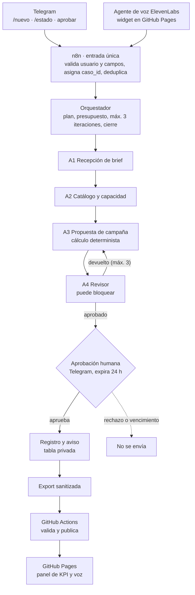

# Caso de negocio — Design & Brand Studio

> Versión 1.0 · 2026-11-04 · Hito 1 (Definir). Consultora y datos **ficticios**. Las cifras de las reglas son **supuestos editables**.

## 1. Empresa, usuario y decisión

**Design & Brand Studio** es una consultora de marketing **ficticia**. Las empresas la contratan para diseñar y ejecutar sus campañas: estrategia, concepto creativo, contenido, video, pauta digital, landing pages, email y reportes. El proyecto automatiza cómo convierte el brief de una empresa cliente en una propuesta de campaña revisada y aprobada.

| Elemento | Descripción | Tipo |
| --- | --- | --- |
| Solicitante | Empresa cliente de prueba, con seudónimo, que envía su brief por Telegram o por voz | Definición del diseño |
| Usuario que decide | Coordinadora de cuentas: revisa la propuesta y la aprueba o rechaza en Telegram | Definición del diseño |
| Problema | Cotizar una campaña exige cruzar servicios, semanas, canales, capacidad del equipo e industria. A mano es lento, propenso a errores de cálculo y a comprometer horas que el equipo no tiene | **Supuesto**: no hay línea base medida |
| Decisión | ¿Se envía esta propuesta y se reservan horas del equipo, se pide un ajuste o se rechaza? | Definición del diseño |

## 2. Proceso delimitado

- **Inicio:** llega un brief por Telegram (`/nuevo`) o por el agente de voz y recibe un `caso_id`.
- **Fin:** la propuesta de campaña revisada queda **aprobada, rechazada o vencida** por la coordinadora de cuentas, registrada y notificada a la empresa cliente.
- **Fuera de alcance:** firma de contrato, facturación y cobro, compra de pauta en las plataformas, producción y ejecución de la campaña, contratación de personal y CRM.

## 3. Entradas, fuentes, reglas, salida y aprobación

### Entradas obligatorias

| Campo | Formato | Validación |
| --- | --- | --- |
| tipo_campana | lanzamiento / posicionamiento / temporada / generacion_leads | Lista cerrada |
| objetivo | awareness / leads / ventas / trafico | Lista cerrada |
| industria | Clave de industria | Debe existir en `industrias.csv` |
| fecha_inicio | AAAA-MM-DD | Regla R1 |
| duracion_semanas | Entero | Regla R2 |
| servicios | Lista de claves de servicio | Deben existir en `catalogo_servicios.csv`; R2 |
| canales | meta / google / tiktok / linkedin / email | Lista cerrada; R7 |
| presupuesto_pauta_semanal | MXN por semana | Obligatorio si incluye pauta (S-PAU01); R2 |
| presupuesto_cliente | MXN, opcional | Número positivo; R8 |

### Fuentes permitidas

Todas son ficticias. No hay otras fuentes ni búsqueda web.

- `catalogo_servicios.csv`: precio, costo y horas por servicio; tipo de cobro (fijo o semanal); dependencias y canales.
- `industrias.csv`: marca si la industria está regulada.
- `capacidad_equipo`: horas libres por semana y por mes (tabla privada en n8n).
- `politicas.md`.

### Reglas de negocio (supuestos editables)

| ID | Regla | Si no se cumple |
| --- | --- | --- |
| R1 | La campaña inicia al menos 10 días después de la solicitud | Rechazo con motivo |
| R2 | Duración de 2 a 12 semanas; de 1 a 8 servicios; con pauta, mínimo 5,000 MXN por semana | Rechazo con motivo |
| R3 | Carga semanal promedio (horas totales / semanas) ≤ horas libres por semana en el mes de inicio | Proponer otra fecha; no reservar |
| R4 | Honorarios = Σ servicios fijos + Σ servicios semanales × semanas. La pauta (S-PAU01) agrega el reporte semanal (S-REP01) | — |
| R5 | 8 % de descuento si los honorarios superan 150,000 MXN y el margen resultante no baja de 35 %. IVA 16 % sobre honorarios con descuento. La inversión en pauta se informa aparte: el cliente la paga directo a las plataformas | Sin descuento si rompería R6 |
| R6 | Margen = (honorarios con descuento − costo) / honorarios con descuento ≥ 35 % | El revisor devuelve la propuesta |
| R7 | Industria regulada (salud, financiera, bebidas alcohólicas, apuestas) o servicio sin canal compatible | Escalar a revisión humana |
| R8 | Si presupuesto_cliente < total, informar la diferencia y sugerir la duración máxima (≥ 2 semanas) que cabe | Nunca bajar el margen |
| R9 | Propuesta vigente 10 días; la aprobación interna expira en 24 h | Estado "vencida" |

### Salida útil

Propuesta de campaña con:
- `caso_id` y versión.
- Servicios con su importe (incluidos los agregados por dependencia).
- Honorarios, descuento, IVA y total en MXN.
- Inversión en pauta informativa.
- Horas de equipo, supuestos y vigencia.
- El rótulo **RESULTADO SIMULADO**.

Nunca promete resultados de la campaña.

### Acción con aprobación humana

"Enviar la propuesta a la empresa cliente y reservar las horas del equipo" (simulada).
- Botones Aprobar y Rechazar en Telegram, ligados a `caso_id`, versión y usuario autorizado.
- Sin respuesta en 24 h, la acción no se ejecuta.

## 4. Orquestador y cuatro agentes

Cada rol recibe la salida del anterior y aporta algo que los demás no hacen. El cálculo lo hace una función determinista, no el texto del modelo.

| Rol | Recibe | Hace | Entrega |
| --- | --- | --- | --- |
| Orquestador | Brief validado por n8n | Planifica, invoca en orden, controla presupuesto y máximo 3 iteraciones, cierra el caso | Plan, estados y respuesta final con `caso_id` |
| A1 Recepción de brief | Texto o transcripción de la empresa cliente | Extrae y normaliza los campos del brief y mapea servicios y canales al catálogo | Requerimiento JSON o lista de datos faltantes |
| A2 Catálogo y capacidad | Requerimiento + consulta a tablas | Verifica cobertura del catálogo, dependencias (R4), capacidad (R3), industria y canales (R7) | Datos con referencia a la fila de la fuente, o "insuficiente" |
| A3 Propuesta de campaña | Cálculo determinista (R4, R5, R8) | Redacta la propuesta con las cifras exactas, sin prometer resultados | Propuesta versionada con supuestos explícitos |
| A4 Revisor | Propuesta y datos | Recalcula, verifica margen (R6), promesas, pauta separada y políticas; puede bloquear | Aprobada o devuelta con correcciones concretas |

## 5. Tres KPI del proceso

Los tres KPI se calcularán solo con registros del sistema. Hoy no hay valores medidos ni línea base.

| KPI | Fórmula | Unidad | Periodo | Fuente |
| --- | --- | --- | --- | --- |
| K1 Tiempo a propuesta lista | Mediana de (ts_propuesta_lista − ts_solicitud) en casos que llegan a aprobación | Minutos | Semanal | Tabla privada de casos, campos de fecha y hora |
| K2 Tasa de aprobación humana | Aprobadas / (aprobadas + rechazadas + vencidas) | % | Semanal | Tabla de casos, campo `decision` |
| K3 Costo variable por caso completado | Suma del costo variable de casos completados / número de casos completados; los fallidos se reportan aparte | USD por caso (MXN con tipo de cambio, fuente y fecha) | Mensual | `costos.csv` |

- **Medido:** solo lo que salga de los casos de prueba (mínimo 3 completos y 1 de error, según la guía).
- **Metas:** por definir después de la primera medición; no se fijan sin datos.
- **Beneficio esperado (hipótesis):** reducir tiempo y errores frente a cotizar a mano. No se medirá contra un proceso manual, así que no se afirmará como resultado.

## 6. Datos ficticios, servicios en vivo y acciones simuladas

| Elemento | Estado | Nota |
| --- | --- | --- |
| Consultora, empresas cliente (seudónimos), catálogo, costos, horas, industrias, capacidad y políticas | Ficticio | Muestra sanitizada en el repositorio |
| Bot de Telegram, n8n Cloud, Claude (Anthropic), ElevenLabs, GitHub Pages, GitHub Actions y Data Tables | En vivo | Puede generar cargos reales aunque la operación sea simulada |
| Envío de la propuesta a la empresa cliente y reserva de horas del equipo | Simulado | Solo cambia el estado del caso y lo rotula |
| Contrato, cobro, compra de pauta y ejecución de la campaña | No se implementa | Fuera de alcance |

## 7. Mapa de integración

Una misma solicitud conserva su `caso_id` desde Telegram o la voz hasta el panel publicado.

Si el revisor devuelve la propuesta, A3 la corrige hasta 3 veces. Si se agotan los intentos, el caso se detiene. Solo una aprobación válida libera la acción simulada.

## 8. Decisiones tomadas y pendientes

- [x] Consultora de marketing ficticia: Design & Brand Studio
- [x] Modelo de lenguaje: Anthropic (Claude), llamado por HTTP desde n8n
- [x] n8n Cloud; registro privado en n8n Data Tables
- [ ] Confirmar cifras de las reglas R1 a R9 y del catálogo
- [ ] Definir la cuenta de Telegram de la coordinadora de cuentas y una cuenta solicitante de prueba
